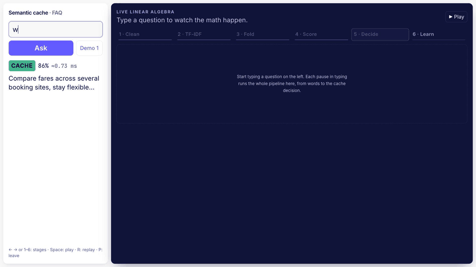
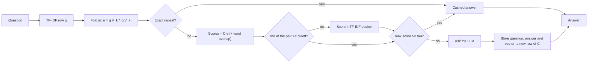

# Semantic cache for NLP queries

A cache that sits in front of an LLM and answers a question from memory when it **means the same** as one answered before, even if the words differ. Every step is linear algebra, written from scratch in [`semcache/linalg.py`](semcache/linalg.py): TF-IDF weighting, Gram-Schmidt QR, Jacobi eigen-decomposition, randomized truncated SVD (LSA), fold-in, cosine similarity, a latent-coverage guard and random-hyperplane LSH. NumPy's own `linalg.svd/eig/qr` are used only in the tests, as the answer key.

```
"cheap flight tickets to goa"  ->  TF-IDF row  ->  fold into SVD space  ->  cosine vs. cache  ->  hit (0.86 >= tau)
                                                                                                    "Compare fares across..."
```



## Contents

- [File tree](#file-tree)
- [How it works (the math)](#how-it-works)
- [Setup](#setup)
- [Run it](#run-it)
- [Presenting](#presenting)
- [Metrics](#metrics)
- [Evaluation](#evaluation)
- [Configuration](#configuration)
- [Multiple users, admin and privacy](#multiple-users-admin-and-privacy)
- [API](#api)
- [Sharing the project](#sharing-the-project)
- [Choices made in this build](#choices-made-in-this-build)
- [Suggested team split](#suggested-team-split)
- [Ideas to extend it](#ideas-to-extend-it)

## File tree

```
semantic-cache/
├── semcache/                     the Python package
│   ├── linalg.py                 ★ every matrix operation, from scratch (the file the rest calls)
│   ├── text.py                   tokenizer, stopwords, plural folding, vocabulary
│   ├── embedder.py               LSAEmbedder: fit TF-IDF + SVD, embed new text, rho, save/load
│   ├── cache.py                  SemanticCache: exact layer, guarded hybrid score, LRU, LSH, persistence
│   ├── backends.py               who answers a miss: Ollama (with warm-up and token counts), or the stub
│   ├── pipeline.py               SemanticCacheService: ask, explain, force refresh, admin, privacy, reset-demo
│   ├── explain.py                every number behind one lookup, for the live math panel
│   ├── metrics.py                request events, counters, latency, estimated cost, time series
│   ├── preflight.py              PASS/FAIL checks before going on stage
│   ├── users.py                  users and their conversation threads
│   ├── context.py                follow-up detection and the history sent to the LLM
│   ├── data.py                   FAQ and Quora Question Pairs loaders
│   ├── evaluate.py               threshold / rank / blend / guard sweeps, cache simulation, latency, charts
│   ├── viz.py                    SVG angle picture and spectrum (Gradio and the notebook)
│   ├── config.py                 settings and profiles, read from config.toml
│   ├── cli.py, __main__.py       python -m semcache <command>
├── apps/
│   ├── api.py                    FastAPI backend for the React UI (also serves the built UI)
│   └── gradio_app.py             Gradio demo
├── frontend/                     Vite + React + TypeScript + Tailwind, KaTeX, uPlot
│   ├── src/App.tsx               layout, live explain, stage player, presentation mode, keys
│   ├── src/components/           LiveMathPanel + stages/ (the six stages), AnswerCard, QuestionBox,
│   │                             PresentStrip, StatsCards, PerformanceChart, CachePanel, ModelPanel, ...
│   └── dist/                     prebuilt UI, so it runs with Python alone
├── data/faq.csv                  43 demo Q&As in 6 topics, with paraphrases and held-out phrasings
├── data/demo_script.json         the six stage-demo presets (UI, preflight and scripts read it)
├── notebooks/walkthrough.ipynb   the linear algebra step by step (Colab-ready)
├── scripts/
│   ├── download_qqp.py           Quora Question Pairs -> data/quora/train.csv, validation.csv
│   ├── check_demo.py             the presets on a fresh FAQ cache (temporary folder)
│   ├── screenshots.mjs           screenshots at 3 resolutions + recording frames (headless Chrome)
│   ├── make_gif.py               recording frames -> GIF
│   └── package_zip.py            a clean zip for teammates
├── docs/screenshots/             the six-stage GIF and 1920 x 1080 screenshots
├── tests/                        linalg vs NumPy, cache, guard, pipeline, API, metrics, preflight, ...
├── config.toml                   every setting in one place, plus the two profiles
├── requirements.txt              runtime dependencies
├── requirements-dev.txt          tests, notebook, dataset download
└── pyproject.toml                package metadata, pytest settings
```

Who calls what in `linalg.py`:

| Caller | linalg functions used |
|---|---|
| `embedder.fit` | `term_frequency_matrix`, `document_frequency`, `inverse_document_frequency`, `tfidf_matrix`, `zero_columns` (latent stopwords), `truncated_svd` (→ `exact_svd` or `randomized_svd` → `gram_schmidt_qr`, `jacobi_eigh`), `frobenius_norm_sq` |
| `embedder.encode` | `tfidf_matrix`, `project` (→ `fold_in`), `l2_normalize_rows`, `latent_coverage` |
| `cache.lookup` | `cosine_scores`, `sparse_row_scores`, `guarded_scores` (→ `blend_scores`), `top_k`, `RandomHyperplaneLSH` |
| `evaluate` | `rowwise_cosine`, `project`, `guarded_scores`, `lsh_collision_probability` |

## How it works



**1. TF-IDF.** Each question $d$ becomes a row of the matrix $X$ (questions × terms), with sublinear term frequency and smoothed inverse document frequency:

$$
X_{dt} = \bigl(1 + \ln \mathrm{tf}(t,d)\bigr)\left(\ln\frac{1+N}{1+\mathrm{df}(t)} + 1\right),
\qquad x_d \leftarrow \frac{x_d}{\lVert x_d \rVert_2}
$$

After normalising, the dot product of two rows is their cosine similarity.

**2. Truncated SVD (latent semantic analysis).** Keep the $k$ strongest directions:

$$
X \approx U_k \Sigma_k V_k^{\top}, \qquad \sigma_1 \ge \sigma_2 \ge \dots \ge \sigma_k
$$

Words that appear in similar contexts ("cheap", "low cost", "budget") end up in the same directions, which is how the cache recognises a paraphrase. For large sparse matrices `randomized_svd` (Halko, Martinsson & Tropp) samples the range of $X$ and refines it with power iterations:

$$
Y = (X X^{\top})^{q} X \Omega, \qquad Q = \mathrm{orth}(Y), \qquad B = Q^{\top} X
$$

$Q$ comes from our Gram-Schmidt QR, and the small $B$ is decomposed through the eigenvalues of $B B^{\top}$ with our Jacobi solver. Small matrices go straight to `exact_svd`, which uses $X^{\top}X = V \Sigma^{2} V^{\top}$.

**3. Fold-in.** A new question $q$ (a TF-IDF row) is placed in the latent space without recomputing the SVD:

$$
\hat q = q\, V_k\, \Sigma_k^{-1}, \qquad e = \frac{\hat q\, \Sigma_k}{\lVert \hat q\, \Sigma_k \rVert} = \frac{q V_k}{\lVert q V_k \rVert}
$$

(The textbook form $\hat q = \Sigma_k^{-1} U_k^{\top} q$ is the same thing for a terms × documents matrix.)

**4. Lookup.** All cached vectors are the rows of one matrix $C$, so every similarity is a single product, and the hit rule is a threshold:

$$
s = C\, e, \qquad \text{hit} \iff \max_i s_i \ge \tau \iff \theta \le \arccos \tau
$$

**5. Hybrid score (Quora profile).** With `lsa_weight` $w < 1$ every entry is also scored by exact-word overlap, which keeps rare words such as names and version numbers that the SVD may discard:

$$
s_i = w \cos_{\text{LSA}}(q, c_i) + (1 - w) \cos_{\text{TF-IDF}}(q, c_i)
$$

**6. Latent-coverage guard ($\rho$).** How much of a question survives in the $k$-dimensional space:

$$
\rho(q) = \frac{\lVert q V_k \rVert}{\lVert q \rVert} \in [0, 1]
$$

$V_k$ has orthonormal columns, so $q V_k$ is the projection of $q$ onto the kept directions. If the smaller $\rho$ of a (question, cached question) pair is below `min_latent_coverage`, their latent cosine means little (both may have collapsed onto "what" or "how"), so that pair is **scored by word overlap (TF-IDF)** instead, and the UI says so.

**7. LSH (optional, for big caches).** Each table hashes a vector to the signs of $b$ random projections. Two vectors at angle $\theta$ share a bit with probability $1 - \theta/\pi$, so with $L$ tables a neighbour is found with probability

$$
P(\text{candidate}) = 1 - \left(1 - \left(1 - \frac{\theta}{\pi}\right)^{b}\right)^{L}
$$

Two more safety rules sit around the math: an **exact-match layer** (a repeated question is always a hit), and a **known-word guard**: if fewer than `min_known_ratio` of a question's words are in the vocabulary, it may hit only by exact repeat.

**The live math panel** (`/api/explain`) shows all of this for the question being typed, in six stages, with the real numbers: clean the text, the TF-IDF row, the fold into meaning space (the question's own rows of $V_k$ slide out, are weighted and summed into $e$; both $\rho$ values), $s = C e$ over the cache matrix, the decision (bars, $\tau$, the angle fan), and learning (the new answer's vector joins $C$ as a new row). Its per-word and per-direction parts are exact: with $t_a$ the latent vector of term $a$ and $z_q = \sum_a q_a t_a$,

$$
\cos(q, c) = \sum_{a,b} \frac{q_a\, c_b\, (t_a \cdot t_b)}{\lVert z_q \rVert\, \lVert z_c \rVert} = \sum_j e_j f_j
$$

## Setup

Python 3.12 (3.11 or newer works).

**macOS / Linux**

```bash
cd semantic-cache
python3.12 -m venv .venv
source .venv/bin/activate
pip install -r requirements.txt
```

**Windows (PowerShell)**

```powershell
cd semantic-cache
py -3.12 -m venv .venv
.venv\Scripts\Activate.ps1
pip install -r requirements.txt
```

**Google Colab**

```python
!git clone https://github.com/<your-team>/semantic-cache.git   # or upload the zip and unzip it
%cd semantic-cache
%pip install -r requirements.txt
!python -m semcache build
```

Then open `notebooks/walkthrough.ipynb`, or run `!python -m semcache gradio --share` for a public demo link.

**Ollama (real answers on a miss).** Install it from [ollama.com](https://ollama.com), then pull a small instruct model:

```bash
ollama pull llama3.2:3b
python -m semcache backend        # checks the connection and lists your models
```

`model = "auto"` in `config.toml` uses the first model you have pulled; set a name to pick one. When `serve` starts it loads the model in the background (the header shows "Model warming up…" until it is ready). Without Ollama, misses get a clearly labelled placeholder answer, so everything still runs.

## Run it

**1. Profiles.** Two model profiles, each with its own model, cache, evaluation and metrics in `artifacts/<profile>/` (users and conversations are shared in `artifacts/users/`). Every command takes `--profile`; the default is `faq`.

| Profile | Corpus | Model | Score | Use it for |
|---|---|---|---|---|
| `faq` | the 172 FAQ texts | $k$ = 60, 327 terms | pure LSA | the stage demo and the slides |
| `quora` | 100,000 Quora questions + the FAQ (100,172 texts) | $k$ = 200, 40,000 terms | hybrid (0.5), $\rho$ cutoff 0.25 | the evaluation |

```bash
python -m semcache build --profile faq           # seconds
pip install datasets
python scripts/download_qqp.py                   # ~364k labelled Quora pairs into data/quora/
python -m semcache build --profile quora         # a few seconds; refuses to run without data/quora
```

Rebuilding keeps the answers already in the cache and re-embeds them with the new model; `--fresh` starts over with the FAQ only.

**2. Command line**

```bash
python -m semcache ask "i forgot my password, how can i reset it"
python -m semcache chat --user priya             # keeps a conversation: :new, :threads, :open ID, :history
python -m semcache entries --limit 20            # what is cached
python -m semcache warm                          # put back missing FAQ answers, keep everything else
python -m semcache reset-demo                    # exactly the 43 FAQ answers, metrics archived, counters zeroed
python -m semcache preflight                     # PASS/FAIL checks before going on stage
python -m semcache evaluate                      # the evaluation report (see below)
python -m semcache users                         # also: threads --user NAME, stats, backend, reset
```

**3. Web UI (FastAPI backend)**

```bash
python -m semcache serve --profile faq           # open http://127.0.0.1:8000
```

The left column has the question box (with a **Demo script** menu and a **Force refresh (skip cache)** checkbox), the answer card (source CACHE / LLM / FOLLOW-UP / FALLBACK, similarity %, time, $\rho$) and the conversation. The right column is the **live math panel**: it re-runs `/api/explain` 250 ms after you stop typing and plays the six stages. Below the fold: live stats, the "Cache performance over time" chart (everyone or just you), the cached answers with the admin area, and what the SVD learned.

The UI is built for laptop and projector screens: the minimum supported width is **1280 px** (checked at 1920×1080, 1440×900 and 1280×720). Narrower windows stack the columns but are not tuned.

**Presentation mode** (button in the header, or **P**): full screen, a compact strip on the left (question, Ask, verdict, the answer in two lines) and the current stage filling the rest, with text sized to the screen (28 px at 1080p) and the drawings scaled up. Keys (not while the question box has focus; **Esc** leaves it):

| Key | Action |
|---|---|
| **P** | enter / leave presentation mode |
| **Space** | play / pause the stages |
| **←** / **→** | previous / next stage |
| **1**–**6** | jump to a stage |
| **R** | replay the stages for the last question |

The prebuilt UI in `frontend/dist` is served directly. To work on the frontend:

```bash
cd frontend
npm install
npm run dev                        # http://localhost:5173, proxies /api to port 8000
npm run build                      # refresh frontend/dist
```

Interactive API docs: http://127.0.0.1:8000/docs

**4. Gradio demo:** `python -m semcache gradio` (http://127.0.0.1:7860, `--share` for a public link).

**5. Notebook:** `notebooks/walkthrough.ipynb` (uses its own `artifacts/notebook` folder).

**6. Tests**

```bash
pip install -r requirements-dev.txt
pytest                              # the Quora regression test is skipped without data/quora
python scripts/check_demo.py        # the six presets on a fresh FAQ cache, in a temporary folder
```

## Presenting

A checklist anyone in the team can follow. Run it before every rehearsal and before the real presentation.

1. **Start Ollama:** open the Ollama app, or run `ollama serve` in a terminal and leave it open.
2. **Reset the demo:** `python -m semcache reset-demo --profile faq`. Preset 3 only misses on a fresh cache: after a rehearsal it would hit its own earlier answer.
3. **Start the server with an admin key:**
   ```bash
   export SEMCACHE_ADMIN_KEY='choose-a-passphrase'      # PowerShell: $env:SEMCACHE_ADMIN_KEY = '...'
   python -m semcache serve --profile faq
   ```
   Wait until the header says **Ollama · llama3.2:3b** (not "Model warming up…").
4. **Check:** in a second terminal, `python -m semcache preflight --profile faq`. Every line must say PASS.
5. **Open the page** (http://127.0.0.1:8000). Type a name, click **I have an admin key**, enter the passphrase and continue (the key is kept only for that browser tab). If the page signs you straight in, click **switch** in the header first. The header then shows your name with an **admin** badge.
6. **Press P** for presentation mode.
7. **Run presets 1–6 in order** with the **Demo** button in the strip (or the Demo script menu), pressing **Ask** after each:

   | # | Preset | Question | What happens | Score |
   |---|---|---|---|---:|
   | 1 | Exact repeat | How do I reset my password if I forgot it? | hit, before any math | 1.000 |
   | 2 | Paraphrase hit | cheap flight tickets to goa | hit through the SVD | 0.858 |
   | 3 | Miss that grows C | what is the best laptop for students | miss: the model answers, stage 6 adds a row to C | 0.390 |
   | 4 | Its paraphrase | best student laptop | hit on the row preset 3 just added | 0.881 |
   | 5 | Follow-up | and what about for gaming? | follow-up: skips the cache, goes to the model with the conversation | |
   | 6 | Blocked by the guard | what is the capital of france | blocked: most words unknown, only an exact repeat could hit | |

8. **Afterwards**, and again before the next run: `python -m semcache reset-demo --profile faq` (or **Reset demo** in the admin area of the page).

**If Ollama fails on stage.** If Ollama stops while the server runs, misses are answered by the placeholder automatically, but those answers are never cached, so preset 4 would miss. Restart the server on the stub backend instead (no config edit needed):

```bash
python -m semcache reset-demo --profile faq
python -m semcache serve --profile faq --backend stub        # or SEMCACHE_LLM_BACKEND=stub
```

All six presets then behave exactly as in the table and every stage of the math is unchanged. The audience sees **Stub backend** in the header and, for presets 3, 5 and 6, an answer that reads "[Placeholder answer - no LLM connected] … Your question was: …" instead of a model answer. Preflight's LLM line fails in this situation (Ollama is down); the cache and preset lines must still pass.

## Metrics

Every `/api/ask` appends one event to `artifacts/<profile>/metrics/events.jsonl` (append-only, so the stats survive a restart). `/api/explain` and `/api/lookup` never count. `GET /api/metrics?bucket=10s&scope=global|user` returns:

- **Counters:** requests, cache hits, misses, LLM calls (misses + follow-ups + forced refreshes), LLM fallbacks (Ollama failed, the placeholder answered), follow-ups, forced refreshes.
- **Hit rate (of cache lookups)** = hits / (hits + misses): follow-ups and forced refreshes skip the cache, so they are left out. `hit_rate_of_requests` = hits / requests is returned too.
- **Latency:** average overall, for cache hits, and for LLM answers; **time saved** = hits × (average LLM latency − average cache-hit latency), shown as "—" until there is a non-fallback LLM answer.
- **Estimated cost** (a what-if: Ollama is free locally). Token counts come from Ollama's `prompt_eval_count` and `eval_count`. Set prices in `[metrics]` (`price_per_1k_input_tokens`, `price_per_1k_output_tokens`, or a flat `cost_per_llm_call_usd`, plus a `price_note`); the cards then show "Est. LLM cost" and "Est. savings", always labelled "estimated at … per 1K tokens". A hit is priced with the tokens its cached answer cost when it was generated, or the average per LLM call when that is unknown (FAQ answers).
- **Time series:** per bucket, the cumulative hit rate and total requests (the chart).

**Reset metrics** (admin) archives the file as `events-<time>.jsonl` and starts over; **Reset demo** does that too.

## Evaluation

```bash
python -m semcache evaluate --profile quora                  # report.md, report.json and charts
python -m semcache evaluate --profile quora --guard-sweep     # latent stopwords x k x rho cutoff (about a minute)
python -m semcache evaluate --profile faq                     # the FAQ's own held-out phrasings
```

Writes `artifacts/<profile>/eval/report.md`, `report.json` and five charts:

| Chart | What it answers |
|---|---|
| `singular_values.png` | How fast does the spectrum decay, and how much energy do $k$ directions keep? |
| `threshold_sweep.png` | Precision, recall and F1 for every $\tau$ |
| `rank_sweep.png` | ROC AUC and F1 as $k$ grows, against TF-IDF with no SVD |
| `cache_simulation.png` | Cache question 1 of each pair, ask question 2: right hits vs certainly-wrong hits |
| `latency.png` | Lookup time vs cache size, brute force vs LSH |

Every score in the report is the one the cache uses, guard included. The report also has a **blend sweep** over `lsa_weight`.

### Results

| | FAQ profile | Quora profile |
|---|---:|---:|
| Evaluated on | 172 FAQ held-out pairs (a smoke test) | 20,000 Quora validation pairs |
| Corpus, $k$, vocabulary | 172 texts, 60, 327 terms | 100,172 texts, 200, 40,000 terms |
| Score | pure LSA | hybrid, `lsa_weight` = 0.5, $\rho$ cutoff 0.25 |
| ROC AUC | 0.973 | 0.704 (LSA only 0.684, TF-IDF only 0.690) |
| Precision / recall at $\tau$ = 0.70 | 0.983 / 0.674 | 0.511 / 0.462 |
| Best F1 (a finding, not a setting) | 0.928 at $\tau$ = 0.40 | 0.624 at $\tau$ = 0.40 |

$\tau$ stays at 0.70 on both profiles: for a cache, a wrong answer costs more than a missed hit, so precision matters more than recall. The best-F1 $\tau$ is reported only as a finding.

**Wrong hits on 1,000 random Quora questions** asked against the 43 FAQ answers (Quora model, $k$ = 200; almost every hit is a wrong answer):

| Score | Wrong hits |
|---|---:|
| Pure LSA | 156 |
| Pure LSA + $\rho$ guard (0.25) | 56 |
| Hybrid (0.5), with or without the guard | 0 (closest call 0.672) |

**Guard sweep** (Quora, $\tau$ = 0.70, hybrid 0.5; full table in `artifacts/quora/eval/guard_sweep.md`):

| Latent stopwords | $k$ | $\rho$ cutoff | AUC | P @ τ | R @ τ | FAQ questions blocked | FAQ held-out blocked | FAQ held-out recall | Known false hits |
|---|---:|---:|---:|---:|---:|---:|---:|---:|---:|
| off | 200 | 0 (off) | 0.710 | 0.520 | 0.445 | 0/43 | 0/86 | 0.105 | 0/4 |
| **off** | **200** | **0.25 (chosen)** | 0.704 | 0.511 | 0.462 | 16/43 | 45/86 | 0.302 | 0/4 |
| off | 200 | 0.30 | 0.703 | 0.512 | 0.458 | 22/43 | 58/86 | 0.314 | 0/4 |
| on | 300 | 0.25 | 0.704 | 0.512 | 0.465 | 13/43 | 38/86 | 0.349 | 0/4 |
| on | 400 | 0.25 | 0.704 | 0.512 | 0.460 | 11/43 | 30/86 | 0.337 | 0/4 |

### Findings from the Quora model

- **Common question words dominate $V_k$.** On Quora, 96% of the 40,000 vocabulary rows of $V_k$ have length below 0.05, while "what" (0.99) and "how" (0.98) keep almost all of theirs. A short question therefore collapses onto the "what" or "how" direction: with pure LSA, "what is the capital of france" scored 0.98 against "What is TF-IDF?". The known-word guard doesn't catch this, because those words *are* in the vocabulary; they just don't survive the SVD.
- **The $\rho$ guard** measures how much of a question survives ("capital of france" 0.13, "how do I lose weight" 0.80). With pure LSA and a cutoff of 0.25 it removes all 4 known false hits and lifts FAQ held-out recall from 0.13 to 0.33, and cuts the random-question wrong hits from 156 to 56. The remaining ones are template collapses that keep a high $\rho$ ("What is the difference between a Rocket and a Missile?" → "What is the difference between PCA and SVD?").
- **The hybrid score** removes the 4 known false hits on its own and gives 0 wrong hits on the random questions, with or without the guard. The guard still helps the FAQ demo questions: held-out recall 0.30 with it, 0.11 without.
- **Settings hardly move the Quora numbers.** Across latent stopwords on/off, $k$ = 200 to 400 and every $\rho$ cutoff, AUC stays at about 0.70 and precision at $\tau$ = 0.70 at about 0.51. Latent stopwords and a larger $k$ changed FAQ held-out recall by at most 4 of 86 paraphrases, so the Quora profile keeps $k$ = 200 with latent stopwords off.
- **The paraphrase demo works only on the FAQ profile.** On Quora, "cheap flight tickets to goa" has $\rho$ = 0.03 and misses. Present with the FAQ profile (the default).

### Speed (measured on our Mac, FAQ profile, llama3.2:3b)

| | Time |
|---|---:|
| Cache hit (embed + lookup) | median 0.8 ms (max 1.3 ms) |
| llama3.2:3b answer (125–193 tokens) | median 1.55 s (1.19–1.89 s) |
| `/api/explain` over HTTP, FAQ profile | median 4.5 ms (max 5.1 ms) |
| `/api/explain` over HTTP, Quora profile | median 17 ms (max 25.5 ms) |

## Configuration

Everything lives in `config.toml`; `[profiles.<name>.<section>]` tables override the base settings for one profile. The settings that matter most:

| Key | Default | Effect |
|---|---|---|
| `profiles.default` | "faq" | profile used without `--profile` or `SEMCACHE_PROFILE` |
| `embedder.rank` | 200 | $k$, the number of SVD directions |
| `embedder.max_rank_fraction` | 0.35 | also caps $k$ at this share of the corpus size (FAQ: 60) |
| `embedder.ngram_max` | 2 | add bigrams ("low cost") as terms |
| `embedder.use_latent_stopwords` | false | leave `latent_stopwords` ("what", "how", ...) out of the SVD fit |
| `cache.threshold` | 0.70 | $\tau$: score needed for a hit |
| `cache.lsa_weight` | 1.0 (Quora: 0.5) | 1 = pure LSA; lower blends in the TF-IDF cosine |
| `cache.min_latent_coverage` | 0.30 (Quora: 0.25) | $\rho$ guard cutoff |
| `cache.min_known_ratio` | 0.5 | share of words that must be known for a semantic hit |
| `cache.use_lsh` | false | approximate search for large caches |
| `cache.max_entries` | 5000 | least recently used entries are evicted beyond this |
| `llm.backend` | "ollama" | or "stub"; `serve --backend stub` or `SEMCACHE_LLM_BACKEND` overrides it |
| `llm.model` | "auto" | first pulled Ollama model, or a name like "llama3.2:3b" |
| `llm.cache_stub_answers` | true | with the stub backend, cache placeholder answers (fallback answers never are) |
| `users.detect_follow_ups` | true | follow-ups skip the cache and use the conversation history |
| `metrics.price_per_1k_*_tokens` | unset | what-if prices for the estimated cost cards |
| `eval.pairs` | "auto" (FAQ: "faq") | which pairs `evaluate` uses |

Changing anything under `[embedder]` or `[corpus]` needs `python -m semcache build --profile NAME`. The cache re-embeds its stored questions automatically when the model changes. Environment variables: `SEMCACHE_PROFILE`, `SEMCACHE_CONFIG`, `SEMCACHE_ARTIFACTS`, `SEMCACHE_ADMIN_KEY`, `SEMCACHE_LLM_BACKEND`.

## Multiple users, admin and privacy

Many people can use one running server. Each person picks a name (no password) and gets:

- **Their own conversations**, stored in `artifacts/users/<name>/`.
- **A shared cache.** A standalone question one person asked is answered from the cache for everyone else. Its LLM answer is generated *without* conversation history, so it makes sense to anyone.
- **Follow-ups that skip the cache.** A message that depends on earlier ones ("and what about Saturn?", "tell me more", "how do I fix it") goes to the LLM with the last few messages of that conversation. Its answer is not cached. Weak signals (so, instead, continue, next step) count only when the message names nothing of its own, so "should I learn java instead of python" stays standalone.
- **Force refresh** (`use_cache: false`): the cache is skipped and the model answers. If the cached answer for that exact question came from the LLM it is replaced; FAQ, admin-added and placeholder answers are never overwritten (the fresh answer is shown, not stored, and the note says so).
- **Privacy.** Users see the FAQ, admin-added answers and their own questions; anyone else's question shows as "another user's question" (in the entries list, the matches and the math panel), though its answer can still be a hit.

**Admin** actions (reset the shared cache, Reset demo, Reset metrics, add or delete shared answers) need the passphrase in the `SEMCACHE_ADMIN_KEY` environment variable of the server, sent as an `X-Admin-Key` header (the **Admin key** field on the sign-in screen). Without the variable they are turned off, with a message saying so. The command line (`reset`, `reset-demo`, `warm`) runs on the server's own disk and needs no key.

Names only keep people apart on a demo or a trusted network: anyone can type someone else's name.

## API

Send `X-User: <name>` to act as a user, and `X-Admin-Key: <passphrase>` for admin actions.

| Method | Path | Body / query | Returns |
|---|---|---|---|
| GET | `/api/health` | | profile, model, cache, backend (with warm-up state), admin enabled |
| POST | `/api/session` | `{name}` | sign in (creates the user); profile and counters |
| GET | `/api/me` | | the signed-in user |
| GET, POST | `/api/threads` | `{title?}` | the user's conversations / start one |
| GET, PATCH, DELETE | `/api/threads/{id}` | `{title}` | one conversation / rename / delete |
| POST | `/api/ask` | `{query, threshold?, top_k?, use_llm?, thread_id?, use_cache?}` | answer, source (CACHE / LLM / FOLLOW-UP / FALLBACK), similarity %, $\rho$, timings, matches, tokens, the new row of C after a miss |
| POST | `/api/lookup` | same | scores, $\rho$ and follow-up verdict only: nothing stored, nothing counted |
| POST | `/api/explain` | same | every number for the six stages: nothing stored, nothing counted |
| GET | `/api/metrics` | `?bucket=10s&scope=global\|user` | counters, latency, estimated cost, time series |
| POST | `/api/metrics/reset` | | admin: archive the metrics and start over |
| GET | `/api/stats` | | cache counters (plus the user's own) |
| GET | `/api/entries` | `?limit=100` | FAQ, admin-added and the user's own entries (admins: all) |
| POST | `/api/entries` | `{question, answer, shared?}` | add a private entry (`shared` needs an admin) |
| DELETE | `/api/entries/{id}` | | remove your entry (shared ones need an admin) |
| POST | `/api/reset` | | admin: reset the shared cache; others: remove their own entries |
| POST | `/api/reset-demo` | | admin: exactly the FAQ answers, metrics archived, counters zeroed |
| GET | `/api/model` | | singular values, energy, top terms per direction |

## Sharing the project

```bash
python scripts/package_zip.py                    # -> ../semantic-cache-YYYYMMDD.zip (about 4 MB)
```

The zip leaves out what each teammate recreates or should not share: `.venv`, `node_modules`, `data/quora`, `artifacts`, `__pycache__`, `.pytest_cache`, `__MACOSX`, `.DS_Store`, `.env` files, and `docs/screenshots` except the GIF. `frontend/dist` is included, so the UI runs with Python alone. After unzipping: create the venv, `pip install -r requirements.txt`, `python -m semcache build --profile faq`.

Screenshots at other sizes are regenerated with `node scripts/screenshots.mjs http://127.0.0.1:8000 docs/screenshots <admin-key>` against a demo server (it does a Reset demo and asks the presets).

## Choices made in this build

- **FAQ content.** 43 general questions in six topics (linear algebra, machine learning, Python, accounts, travel, tech), each with three paraphrases for training and two held-out phrasings for evaluation. Replace `data/faq.csv` with your own domain using the same columns (and re-check the presets with `scripts/check_demo.py`).
- **$\tau$ = 0.70 on both profiles**, chosen for precision; the best-F1 values are findings only.
- **Stopwords** keep negations (not, no), question words (what, how, why) and on/off/up/down, so "turn on" and "turn off" stay different.
- **Placeholder answers are cached only with the explicit stub backend**, so the demo works without Ollama; a fallback answer (Ollama down) is never cached.
- **`frontend/dist` is kept in the repo**, so teammates without Node can run the UI. KaTeX and the fonts are bundled, so the demo works offline.

## Suggested team split

| Person | Owns | Files |
|---|---|---|
| 1 | Matrix core and its tests; the math write-up | `linalg.py`, `tests/test_linalg.py`, notebook sections 1-4 |
| 2 | Data, embedder, rank and guard studies | `text.py`, `embedder.py`, `data.py`, `evaluate.py` (guard sweep), `scripts/` |
| 3 | Cache, LSH, metrics; evaluation report | `cache.py`, `metrics.py`, `evaluate.py` |
| 4 | Pipeline, Ollama, UI and the live demo | `pipeline.py`, `backends.py`, `explain.py`, `apps/`, `frontend/` |

## Ideas to extend it

**Make it more accurate**

1. A negation guard: after a semantic hit, check a small antonym list (enable/disable, on/off, increase/decrease) and refuse the hit if the query and the cached question disagree.
2. Compare with a pretrained sentence-embedding model (MiniLM) behind the same cache interface; then fine-tune it on Quora pairs.
3. Per-region thresholds: run k-means on the cached vectors and learn one $\tau$ per cluster, since dense regions need a stricter threshold.
4. A feedback button ("wrong answer") that evicts the entry and records the pair for threshold tuning.

**Make it scale**

5. Incremental SVD (Brand's update) or a scheduled refit on logged queries, instead of rebuilding from scratch.
6. Batch lookups with one matrix-matrix product, $S = Q C^{\top}$, and a throughput benchmark.
7. LSH parameter sweeps over $b$ and $L$, multi-probe LSH, and a comparison against FAISS.
8. Move entries to SQLite or Redis so several API workers share one cache.

**Make it a product**

9. Time-to-live for time-sensitive questions (weather, prices).
10. Hindi-English queries: align two embedding spaces with orthogonal Procrustes, whose rotation also comes from an SVD.
11. Docker Compose with the API and Ollama.
